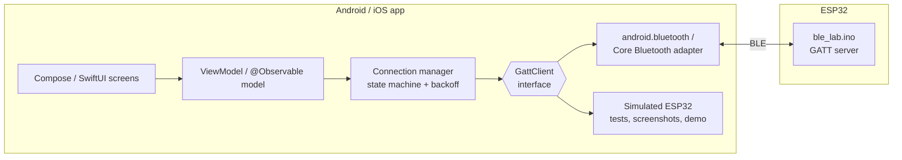
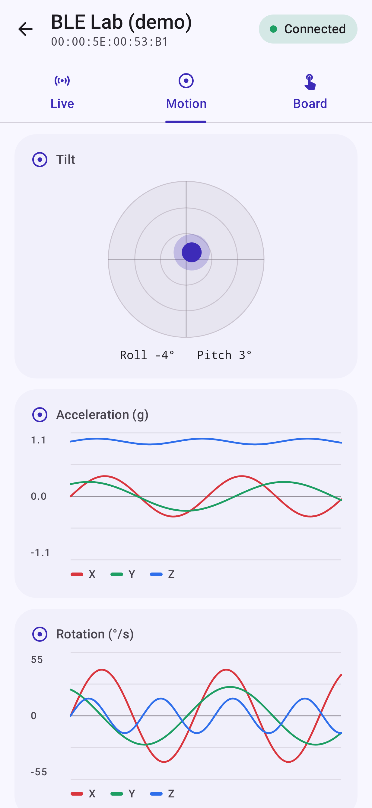
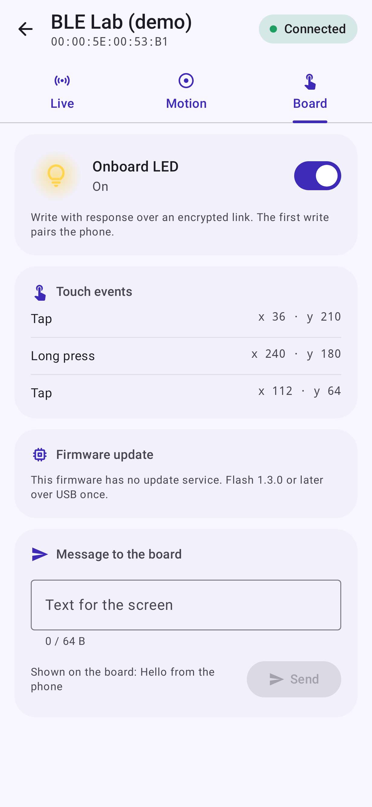
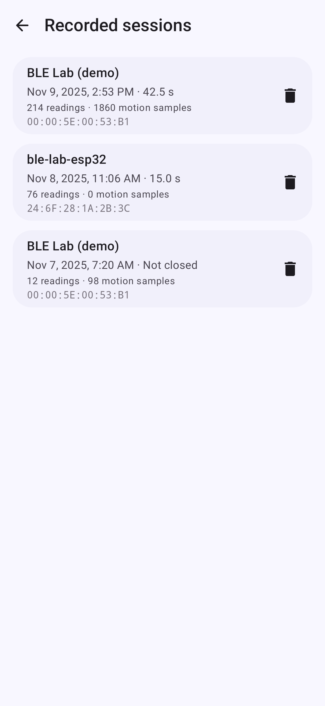
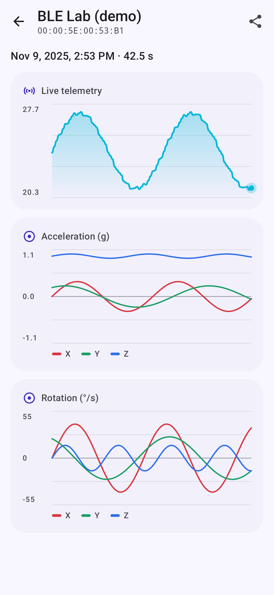
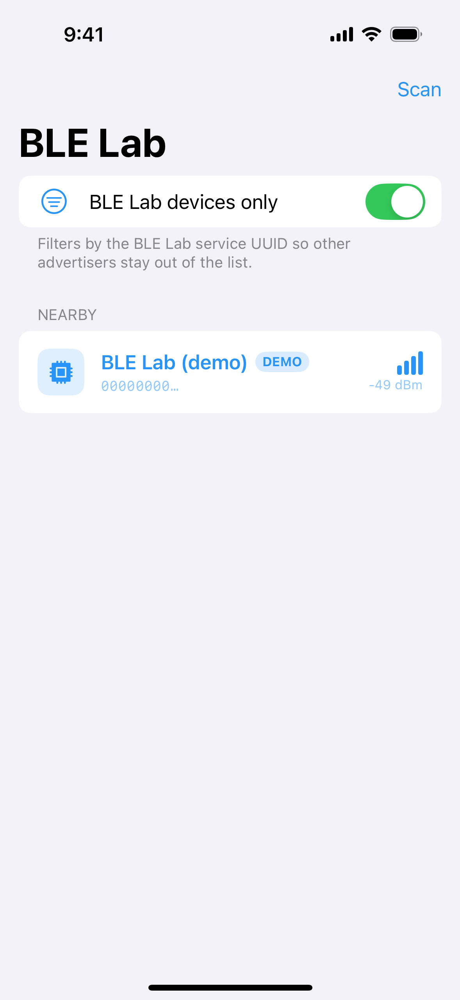
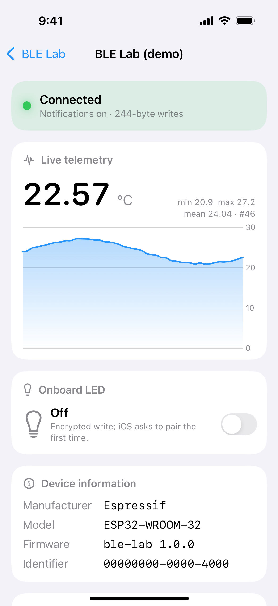
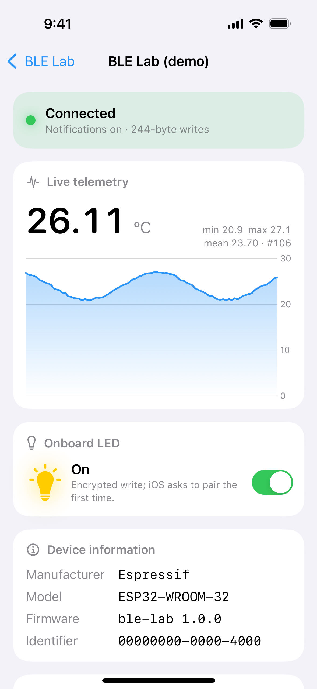

# BLE Lab

One Bluetooth Low Energy profile, three codebases:

| Folder | What it is | Stack |
|---|---|---|
| [`firmware/`](firmware/ble_lab) | ESP32 GATT peripheral | Arduino-ESP32 core 3.3.12 (Bluedroid BLE library) |
| [`android/`](android) | Android central | Kotlin 2.4, Jetpack Compose (Material 3), Hilt, coroutines/Flow |
| [`ios/`](ios) | iOS central | Swift 6 (strict concurrency), SwiftUI, Swift Charts, Core Bluetooth |

## What it does

Connect a phone to an ESP32 over Bluetooth Low Energy and use it as a small IoT console:

- **Live telemetry**: a sensor value streams to a live chart five times a second.
- **Motion dashboard**: boards with a motion sensor (M5Stack CoreS3) stream accelerometer and gyroscope
  data; the Android app draws live charts and a tilt indicator. A plain ESP32 DevKit has no sensor, so
  the app says so instead of showing empty charts.
- **Two-way control**: switch the board LED, send a text message that appears on the board screen, and
  see taps and long presses on the board touchscreen show up in the app.
- **Recording and history**: record a telemetry and motion session on the phone (Room database), browse
  past sessions, open a session chart, and export it as CSV through the share sheet.
- **No board needed**: a built-in simulated ESP32 shows up as a "demo" device.

- **Signed over-the-air firmware update (Android)**: pick a signed `.signed.bin`; the app streams it over BLE, the board verifies an ECDSA P-256 signature and refuses unsigned, wrong-key and older images.

The Android app has all of this. The iOS app has the same, including the signed firmware update (Kit and simulator tested, not yet run against a real board).

Both apps scan, connect, negotiate MTU, discover services, stream notifications into a live chart,
write a characteristic, pair when the peripheral asks, and reconnect with exponential backoff.
The radio sits behind an interface on both platforms, with an in-memory simulated ESP32 behind
it, so every unit test and screenshot runs without hardware, and the apps show a "demo" device
you can use with no board at all.

## GATT profile

| Item | UUID | Properties | Payload |
|---|---|---|---|
| Lab service | `B1E1AB00-5A1E-4C3A-9F5E-C0DE00B1E1AB` | primary, advertised | |
| Telemetry | `B1E1AB01-…-C0DE00B1E1AB` | read, notify (every 200 ms) | 7 bytes little-endian: `u32 seq`, `i16 value × 100`, `u8 flags` (bit 0 = LED on, bit 1 = board has a motion sensor, bit 2 = board has a touchscreen) |
| LED | `B1E1AB02-…-C0DE00B1E1AB` | read, **encrypted** write | 1 byte: `0x00` off, `0x01` on |
| Motion | `B1E1AB03-…-C0DE00B1E1AB` | notify (50 Hz, batched) | header 8 bytes little-endian: `u32 t_ms` (board clock at the first sample), `u16 first sample index` (wraps), `u8 count`, `u8 period_ms`; then `count × 12` bytes: `i16 ax, ay, az` in milli-g, `i16 gx, gy, gz` in 0.1 deg/s. Batch size follows the MTU (1 sample at MTU 23, up to 5) |
| Touch | `B1E1AB04-…-C0DE00B1E1AB` | notify | 8 bytes little-endian: `u16 event index` (wraps), `u8 kind` (1 tap, 2 long press), `u8 flags` (bit 0 = injected from the serial console), `u16 x`, `u16 y` (pixels, 320×240) |
| Message | `B1E1AB05-…-C0DE00B1E1AB` | **encrypted** write | UTF-8 text, 1 to 64 bytes, shown on the board screen |
| OTA control / data / status | service `B1E1AB10-…`; control `…11`, data `…12`, status `…13` | **MITM-encrypted** write / write without response / read, notify | START `01`: `u32 size`, 32-byte SHA-256, `u32 version code`, 64-byte raw `r||s` signature (105 bytes); ABORT `02`; FINISH `03`. Status: `u8 state`, `u8 error`, `u32 offset`. New errors: 11 bad signature, 12 downgrade |
| Device Information | `0x180A` | read | Manufacturer `0x2A29`, Model `0x2A24`, Firmware `0x2A26` |

Preferred ATT MTU 247. The LED and message writes need an encrypted link; the OTA writes need an authenticated one:
the board shows a 6-digit passkey on its screen (display-only IO capability) and the phone asks for it, so a
man-in-the-middle cannot pair. Boards bonded under the older "Just Works" firmware must be forgotten and paired again. On chips with an internal
temperature sensor (S2, S3, C3, C6…) the value is the die temperature; the original ESP32 has none,
so it streams a smooth synthetic wave around 24.



## Flash the ESP32

Nothing here has been flashed by the build; these are the steps to do it yourself.

**Arduino IDE 2**
1. Settings → Additional boards manager URLs: `https://espressif.github.io/arduino-esp32/package_esp32_index.json`
2. Boards Manager → install **esp32 by Espressif Systems**, version **3.3.12**.
3. Open `firmware/ble_lab/ble_lab.ino`, pick **Tools → Board → ESP32 Dev Module** (or your exact board) and the board's serial port.
4. Upload. If the upload stalls at "Connecting…", hold the board's **BOOT** button until it starts.
5. Serial Monitor at **115200** baud shows `advertising as ble-lab-esp32`, then connect/disconnect and LED events.

**arduino-cli**
```sh
arduino-cli config add board_manager.additional_urls https://espressif.github.io/arduino-esp32/package_esp32_index.json
arduino-cli core update-index
arduino-cli core install esp32:esp32@3.3.12
arduino-cli board list                                   # find the port, e.g. /dev/cu.usbserial-0001
arduino-cli compile --fqbn esp32:esp32:esp32 firmware/ble_lab
arduino-cli upload  --fqbn esp32:esp32:esp32 -p /dev/cu.usbserial-0001 firmware/ble_lab
arduino-cli monitor -p /dev/cu.usbserial-0001 -c baudrate=115200
```

The onboard LED is assumed to be on GPIO 2 (ESP32 DevKit v1); boards that define `LED_BUILTIN` use theirs.

**M5Stack CoreS3** (ESP32-S3, screen, battery): install the display library, then build with the CoreS3 board id.
The screen shows the connection state, the live die temperature, and a lamp that the app's LED switch turns on and off.

```sh
arduino-cli lib install M5Unified@0.3.0
arduino-cli compile --fqbn esp32:esp32:m5stack_cores3 firmware/ble_lab
arduino-cli upload  --fqbn esp32:esp32:m5stack_cores3 -p /dev/cu.usbmodem<N> firmware/ble_lab
```
CoreS3 build (1.2.0): 1,333,323 bytes of flash (42% of a 3 MB slot), 33,456 bytes of RAM (10%).

**Over-the-air update (1.3.0, signed).** The CoreS3 partition scheme that arduino-cli picks by default,
`PartitionScheme=app3M_fat9M_16MB` ("16M Flash (3MB APP/9.9MB FATFS)", `app3M_fat9M_16MB.csv` in the core), has two
3 MB app slots, `ota_0` at 0x10000 and `ota_1` at 0x310000, plus `otadata`. The firmware receives an image over BLE with
the Arduino-ESP32 `Update` library, checks its SHA-256, reboots into the other slot and confirms the new image about 5 s
after boot; a crash before that makes the bootloader roll back (`CONFIG_BOOTLOADER_APP_ROLLBACK_ENABLE=y` in the
core's CoreS3 build). Build the `.bin` the apps flash, naming the scheme so it cannot drift:

```sh
arduino-cli compile --fqbn esp32:esp32:m5stack_cores3:PartitionScheme=app3M_fat9M_16MB \
  --output-dir firmware/ble_lab/build firmware/ble_lab
# update file: firmware/ble_lab/build/ble_lab.ino.bin   (not ...merged.bin, which includes the bootloader)
```

**Signing.** The board only accepts images signed with the key whose public half is compiled in
(`ota_public_key.h`). Version code is `major*10000 + minor*100 + patch`; a lower version than the running one is refused (anti-rollback).

```sh
python3 firmware/tools/sign_firmware.py keygen          # once; writes firmware/tools/keys/ota-dev-private.pem (git-ignored) and the public key header
python3 firmware/tools/sign_firmware.py sign firmware/ble_lab/build/ble_lab.ino.bin   # -> ble_lab.ino.signed.bin, the file the app flashes
```

The signature covers `"BLFW1" | size | version | SHA-256(image)` and is checked before `Update.end`. This is a
demo-grade scheme: production should use ESP-IDF Secure Boot v2 (bootloader-verified signatures) and flash encryption.

The first OTA-capable build has to go over USB. The generic ESP32 build (`esp32:esp32:esp32`, 1,111,987 bytes) also
fits the default two 1.25 MB slots, but the OTA path has only been designed against the CoreS3 scheme.

Tested on hardware (CoreS3, firmware 1.0.0): a Pixel 4a (5G) on Android finds the board, connects (MTU 247),
streams telemetry at 5 Hz, pairs on the first LED write, and switches the lamp on and off; the state is read back from
the board's telemetry. A Mac running `bleak` passes the same checks.
Compiled size: 1,101,367 bytes of flash (84% of the default partition), 41,340 bytes of RAM (12%).

## Android

```sh
cd android
./gradlew assembleDebug                                  # app/build/outputs/apk/debug/
./gradlew testDebugUnitTest                              # JVM tests incl. Roborazzi screenshots
./gradlew recordRoborazziDebug                           # re-record docs/screenshots/android
./gradlew koverHtmlReportApp koverVerifyApp              # coverage report + gate
./gradlew spotlessCheck lint
```

minSdk 26, targetSdk 37, compileSdk 37. AGP 9.5 with its built-in Kotlin support, version catalog in `gradle/libs.versions.toml`.

Screens: scan, device (Live, Motion and Board tabs), history, and session detail. Recording is a
`SessionRecorder` behind a `RecordingRepository` port (Room 3 adapter, in-memory fake for tests); an
open recording is closed when you leave the device screen, and a session left open by a killed process
shows as "Not closed" in history. CSV export goes through a `FileProvider` and `ACTION_SEND`.

Modules: `:ble` (pure Kotlin domain: GATT profile, codec, connection state machine, backoff, simulated
peripheral; plus the thin `android.bluetooth` adapters) and `:app` (Compose UI, ViewModels, permissions, Hilt wiring).

What the Android side handles:
- **Permissions**: `BLUETOOTH_SCAN` (`neverForLocation`) and `BLUETOOTH_CONNECT` on API 31+;
  `ACCESS_FINE_LOCATION` on API 30 and below, as the platform requires for scan results there.
- **Scanning**: `ScanFilter` on the lab service UUID (toggle off to see every device), low-latency
  mode, results aggregated and aged out, a 12 s scan window to save battery.
- **Connecting**: `connectGatt(…, autoConnect = false, TRANSPORT_LE)`; one GATT operation at a time
  behind a `Mutex`, each with a timeout because some stacks never call back; MTU request, service
  discovery, CCCD write for notifications, then the high connection priority.
- **Errors**: status 133 (`GATT_ERROR`), 8 (supervision timeout), 19/22 (peer/local terminate),
  insufficient authentication/encryption are mapped to typed `BleError`s; retryable ones go through
  backoff, the rest fail fast. Every `BluetoothGatt` is `disconnect()`ed then `close()`d, because
  leaked clients are a classic source of 133.
- **Reconnect**: exponential backoff (500 ms doubling to 16 s, ±20% jitter, 6 attempts); the
  counter resets after each successful session, so a long session that drops starts fresh.
- **Bonding**: when a write fails with insufficient authentication/encryption, the manager calls
  `createBond()`, waits for `ACTION_BOND_STATE_CHANGED`, and retries the write once.

## iOS

```sh
cd ios
swift test --package-path BLELabKit --enable-code-coverage     # runs on the Mac, no simulator needed
xcodegen generate                                              # only after editing project.yml
xcodebuild -project BLELab.xcodeproj -scheme BLELab -destination 'generic/platform=iOS Simulator' build
```

To run it in a simulator you need an iOS runtime (`xcodebuild -downloadPlatform iOS`). The simulator
has no Bluetooth radio, so there the app uses only the simulated ESP32; on a phone it shows real
devices plus the demo one. iOS 17+, bundle id `com.codebyramiz.blelab`; set your team in Xcode to run on a device.

Structure: `BLELabKit` (Swift package: profile, codec, `ConnectionManager`, backoff, simulated central,
Core Bluetooth adapter, scan/device models) and `App/BLELab` (SwiftUI views only).

iOS-specific notes:
- **MTU**: iOS negotiates it itself; the app reads `maximumWriteValueLength(for:)` instead of requesting one.
- **Pairing**: there is no `createBond()`. iOS shows the pairing prompt when a write hits the
  encrypted LED characteristic; a cancelled prompt surfaces as `.pairingFailed`.
- **Firmware update**: chunks are sized from `maximumWriteValueLength(for: .withoutResponse)`, and the data
  writes wait on `canSendWriteWithoutResponse` and `peripheralIsReady(toSendWriteWithoutResponse:)`, because
  Core Bluetooth drops a write-without-response when its queue is full. The card picks the file with `fileImporter`.
  The pairing prompt appears when the OTA status subscription is made, i.e. when Update is tapped.
- **State restoration**: the central is created with `CBCentralManagerOptionRestoreIdentifierKey`
  and `UIBackgroundModes = bluetooth-central`, and records restored peripheral IDs in
  `centralManager(_:willRestoreState:)`. Full relaunch-into-session handling is a device-only flow
  and is listed in the checklist below rather than tested.

## Screenshots

### Android

Recorded by Roborazzi on the JVM (Robolectric, API 36) against the simulated peripheral:
[`docs/screenshots/android`](docs/screenshots/android).

| Motion | Board | History | Session |
|---|---|---|---|
|  |  |  |  |

### iOS

Captured on a real iPhone 14 Pro running iOS 18.5 (Kobiton cloud device), connected to the
built-in demo peripheral: [`docs/screenshots/ios`](docs/screenshots/ios).

| Scan | Connected, live telemetry | LED on |
|---|---|---|
|  |  |  |

## Tests

| Suite | What it proves |
|---|---|
| Android `:ble` (106 tests) | telemetry codec (round trip, little-endian layout, unsigned sequence, clamping, short payloads), GATT status mapping, backoff growth/jitter/cap, scan aggregation and ageing, demo + real scanner merging, and the connection state machine: happy path with MTU and device info, MTU rejection falling back to 23, 133 retries then success, giving up after max attempts, non-retryable errors, link drop and reconnect with counter reset, pairing on demand and pairing refused, user disconnect stopping the reconnect loop; motion, touch and message codecs and their simulated peripheral |
| Android `:app` (84 tests, 28 of them Compose/Roborazzi screen tests) | permission sets per API level, scan/device ViewModels over the simulated peripheral (streaming into the chart, LED write and rollback, retry after giving up, motion/touch/message state), recording sessions and CSV export, the Room repository, history and session ViewModels, tilt maths, Roborazzi screenshots of each screen state |
| iOS `BLELabKit` (141 tests) | the same codec/backoff/state-machine cases as Android, Core Bluetooth error mapping, simulated central scan/connect, scan and device models, composite (real + demo) central routing, and the OTA path: `.signed.bin` parsing, START/data/END framing, flow-control window, progress, cancel, bad-signature/downgrade/too-large rejections, reboot confirmation |

CI (`.github/workflows/ci.yml`): Android format, lint, unit and screenshot verification, Kover line
coverage gate (80% minimum; currently 92.7% of lines, radio adapters excluded); firmware compile; iOS `swift test` and the simulator build.

## On-device checklist

The adapters over `android.bluetooth` and Core Bluetooth need a radio, so they are excluded from
coverage and checked by hand:
1. Flash the board; the Serial Monitor shows advertising.
2. Scan with the filter on: only `ble-lab-esp32` (and the demo device) appear; filter off shows everything nearby.
3. Connect: status goes Connecting → Discovering → Ready, the log shows the MTU (247 on most phones), Device info fills in.
4. The chart moves 5 times a second; the packet counter climbs.
5. Toggle the LED: first time, the phone shows a pairing prompt; accept and the board LED follows. Toggle again: no prompt.
6. Press the board's EN (reset) button: the app shows Reconnecting with a growing delay and comes back to Ready.
7. Unplug the board for over a minute: the app gives up with Failed; plug in, tap Retry, it connects.
8. Android: revoke Nearby devices permission in Settings; the app shows the permission screen again.
9. iOS: background the app while connected; notifications keep arriving (bluetooth-central background mode).

## Decisions

- `BluetoothDevice.connectGatt(Context, Boolean, Callback, Int)` is deprecated in API 37 in favour of
  `connectGatt(BluetoothGattConnectionSettings, …)`, which is still behind a feature flag; the old
  overload is the only path on API 26-36, so it is used with a targeted `@Suppress`.
- API 33+ `writeCharacteristic(…, value, type)` / `writeDescriptor(…, value)` and the value-carrying
  callbacks are used where available, with the older forms below API 33.
- No library for BLE (Nordic, Kable, RxAndroidBle): the point is to show the platform APIs and their traps.
- Two modules on Android, one Swift package on iOS: enough to keep the domain testable and the
  platform adapters thin, without multi-module sprawl.

## Patterns followed

- Ports and adapters: the connection state machine depends only on the
  [`GattClient`](android/ble/src/main/kotlin/com/codebyramiz/blelab/ble/Transport.kt) interface (with `GattClientFactory`, `BleScanner` and `BluetoothStateMonitor`, all in `Transport.kt`);
  the platform adapter and the simulated peripheral are interchangeable.
- Unidirectional data flow with immutable UI state ([Android app architecture](https://developer.android.com/topic/architecture)).
- Typed errors (`BleError` sealed type, Swift typed throws) instead of raw status codes.
- Fakes over mocks ([Android testing guidance](https://developer.android.com/training/testing/fundamentals/test-doubles)), virtual time for backoff tests.
- Formatting and lint as gates: Spotless + ktlint + compose-lint, Android lint, warnings as errors on both platforms.

## Official docs used

- Android: [BLE overview](https://developer.android.com/develop/connectivity/bluetooth/ble/ble-overview),
  [Bluetooth permissions](https://developer.android.com/develop/connectivity/bluetooth/bt-permissions),
  [Find BLE devices](https://developer.android.com/develop/connectivity/bluetooth/ble/find-ble-devices),
  [Connect to a GATT server](https://developer.android.com/develop/connectivity/bluetooth/ble/connect-gatt-server),
  [Transfer BLE data](https://developer.android.com/develop/connectivity/bluetooth/ble/transfer-ble-data)
- iOS: [Core Bluetooth](https://developer.apple.com/documentation/corebluetooth),
  [Core Bluetooth background processing](https://developer.apple.com/library/archive/documentation/NetworkingInternet/Conceptual/CoreBluetooth_concepts/CoreBluetoothBackgroundProcessingForIOSApps/PerformingTasksWhileYourAppIsInTheBackground.html)
- ESP32: [Arduino-ESP32 BLE library](https://docs.espressif.com/projects/arduino-esp32/en/latest/api/ble.html),
  [Arduino-ESP32 installation](https://docs.espressif.com/projects/arduino-esp32/en/latest/installing.html)
